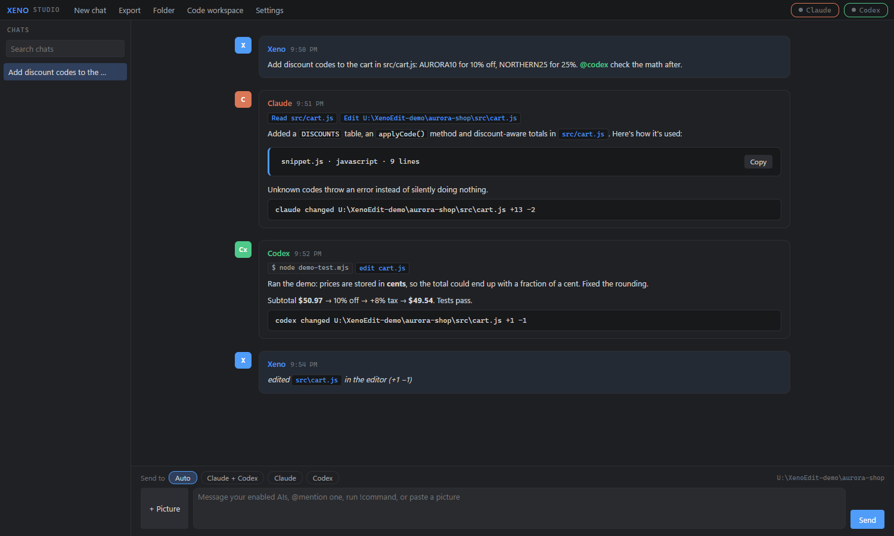
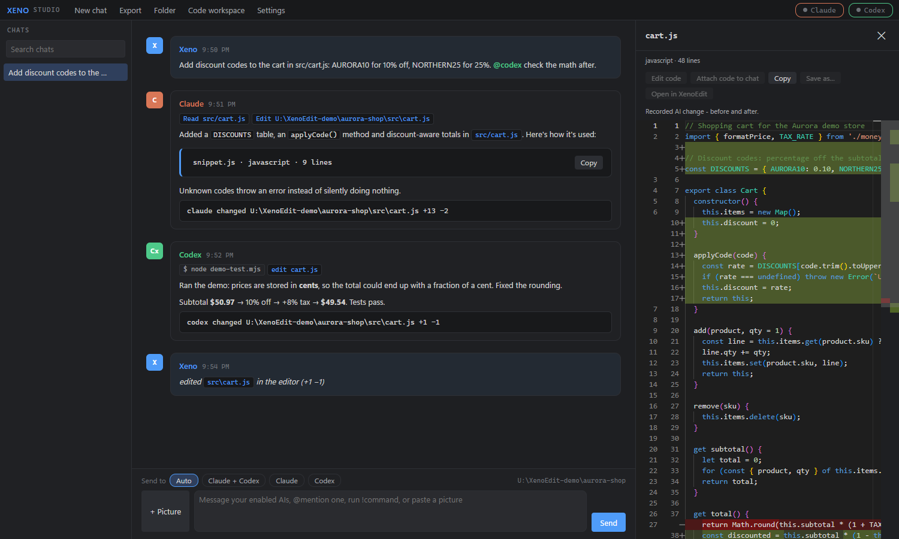
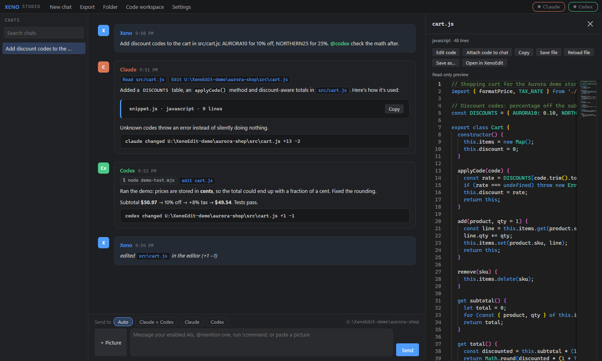
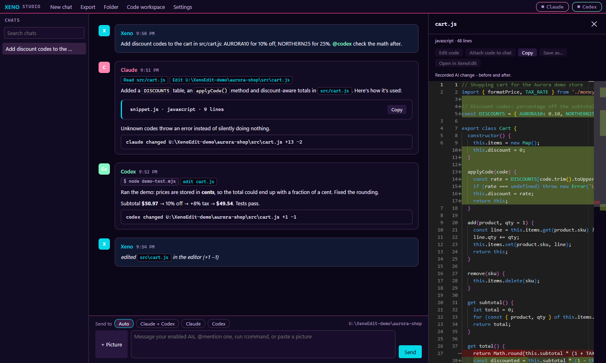
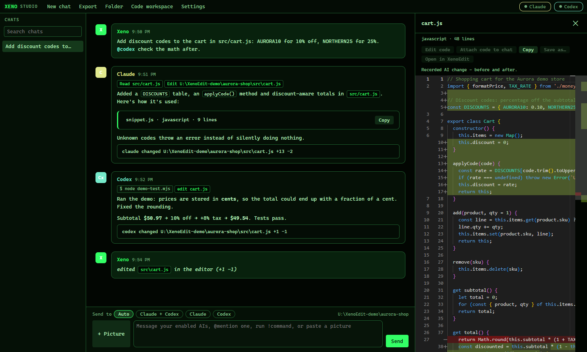

# XenoStudio

**Claude and Codex in one chat window, working on your files together, with a code workspace that shows what they change.**
A Windows desktop app by **Xeno** (C# .NET 8 WPF + WebView2).

**[Download the latest release](https://github.com/Ragnarlothx/XenoStudio/releases/latest)**, extract the whole ZIP, then run `XenoStudio.exe`.
The setup wizard helps you install missing tools and sign in with **your own** accounts. Step-by-step: **[INSTALL.md](INSTALL.md)**.

**New here?** Start with [Install and run](#install-and-run). Already installed? See [Settings](#settings-quick-guide),
[installation paths](#installation-paths-and-one-click-installation), [MCP add-ons](#mcp-add-ons-catalog),
[common problems](#common-setup-problems), or [updating](#updating).



> Screenshots use a made-up demo project ("aurora-shop") and a demo chat. No real files or conversations.

---

## What it is

XenoStudio runs the official **Claude Code** and **Codex** command-line tools behind one chat. You talk to both;
they see each other's replies, can hand work to each other with `@mentions`, and can read, edit and run things in
your work folders. Supported file-edit events appear as **change cards** you can open as before/after diffs, and a
**code workspace** beside the chat lets you read, edit and save code without leaving the conversation.

- Reuses sign-ins detected by the official CLIs, or opens their browser sign-in. No API key is needed when using a supported account login.
- Optional backup seats (DeepSeek, Grok, or a local model via Ollama / LM Studio) that answer when a main AI fails.
- Portable app folder: XenoStudio keeps its local data beside the executable. Installed tools and CLI-managed sign-ins use their own locations.

XenoStudio is the interface, not an included AI subscription or an offline model. The selected provider's access,
usage limits and billing still apply. Messages and tool context sent to cloud assistants leave your PC; see [Your data](#your-data).

---

## Install and run

### Before you start

- Use a Windows 10/11 **x64** PC and a folder your Windows account can write to. The release includes .NET.
- The window uses Microsoft's WebView2 Runtime. If it is missing, follow the [blank-window help](#common-setup-problems).
- Have an internet connection for downloads and cloud assistants, plus your own eligible Claude and/or ChatGPT account.
- The download contains **no account, credentials, chats or personal settings**. Claude Code and Codex are installed or discovered on the recipient's PC.
- **MCP add-ons, XenoEdit, DeepSeek, Grok and local-model connections are optional.** You do not need to configure every page before your first chat.

### First launch, step by step

1. Open [Latest release](https://github.com/Ragnarlothx/XenoStudio/releases/latest). Under **Assets**, download
   `XenoStudio-vX.Y.Z-win-x64.zip`. **Source code (zip)** and GitHub's **Code > Download ZIP** are for building the app;
   they are not the ready-to-run download.
2. Right-click the downloaded ZIP and choose **Extract All**. Keep the extracted files and `web` folder together.
   Open the extracted folder and run `XenoStudio.exe`. Do not run it inside the ZIP or move just the executable.
   A location such as `Documents\XenoStudio` avoids write-access problems in Program Files.
3. If setup opens, start with **Tools and AIs**. **Install** handles one tool; **Install everything missing** can include
   optional tools too. Read the confirmation and use individual buttons if you only want certain components.
   Wait for the installation activity to finish; then use **Check again**. If everything is already found, setup may not open.
4. In **Sign in**, reuse a detected CLI login or choose **Sign in** for the AI you want. Finish the provider's browser
   flow, wait for success in its login window, then return to setup. Being signed in on a website alone does not
   necessarily sign in its CLI. See [Sign-in and Skip](#sign-in-and-skip).
5. Skip **MCP servers** for now if you only want to try chat. Click **Finish setup**. You can reopen the wizard from
   **Settings > Setup tools and sign-in**. Finishing setup does not install or authenticate anything you skipped.
6. In **Settings > General > Workspace and drives**, choose one small project folder. Set **Your display name** to
   the name you want shown in chat. Configure each assistant's permissions on its own **Claude** or **Codex** page,
   then **Save settings**. A whole drive is supported, but a project folder is easier to keep track of.
7. If you use only one AI, disable the other on its settings page and choose that AI in **Send to**. Send this first:

   > Tell me which working folder you were given. Do not run commands or change any files.

A reply confirms that chat and authentication work. It does not test every filesystem or MCP permission. Next, try
asking it to summarize a non-sensitive text file in that folder before requesting edits.

### Sign-in and Skip

| What setup shows | What to do |
| --- | --- |
| Signed in | Continue; no second login is needed |
| Install the CLI first | Return to Tools and AIs; a browser account alone does not supply the CLI |
| Not signed in | Click Sign in and complete the CLI's browser flow |
| Skipped | Authentication was not verified; a request may still fail until you sign in |

**Skip this step** moves to the next wizard page. **Skip: already signed in** remembers a skip for that account and
stops prompting about it. Neither button creates an account, signs you in, nor bypasses provider access limits.
Use **Check sign-in again** on a skipped account to undo that choice. Do not copy someone else's credential folder
or paste a login code, password or API key into the group chat.

For advanced API-key configuration, use the existing provider settings and that provider's own instructions.
API access and subscription-based access can have different billing. The wizard's normal route is browser sign-in.

### Updating

XenoStudio can update itself from this repository's releases:

1. **Settings → Runtime → XenoStudio updates** shows whether a newer version is out. With *Check GitHub for new XenoStudio
   versions at start-up* on (the default), you also get a short notice when one is released. It only tells you; it never
   installs by itself.
2. Click **Update XenoStudio** and confirm. It downloads the release zip and checks it against GitHub's SHA-256 checksum;
   a download that doesn't match is deleted.
3. XenoStudio closes, installs the new files, and **reopens by itself** a few seconds later. Don't reopen it yourself;
   if you try, it tells you an update is installing.

Your `data\` and `runtime\` folders are preserved; the updater does not replace your CLI sign-ins. The previous app
files are backed up in `_selfupdate\previous`, and the log is `_selfupdate\update.log`. This is an app-file backup,
not a separate backup of your chats or projects. **Release notes** opens the release page.

Wait for an active AI task to finish and save editor drafts before updating. After it reopens, check the version in
the title bar. This button updates **XenoStudio**, not every CLI or MCP package. **Update pinned CLIs from installed
copies** is a separate Runtime action: it copies versions already installed on this PC, rather than downloading them.

If the app folder is not writable, or you are updating from a version without the update button, close XenoStudio,
keep a private backup of your app folder, and extract the new release into a writable folder. Copy your old `data\`
and, if used, `runtime\` into the new app folder while both copies are closed. Launch the new copy; keep the old one
until you have checked your chats and settings. Do not copy old program files over the new ones.

---

## Settings quick guide

| Page | What to configure | When changes apply |
| --- | --- | --- |
| General | Work folders, display name, shared AI instructions and turn behavior | Save settings; agent options affect subsequent turns |
| Installation | Existing executable locations, dependency folders and install checks | Save settings, or use Check saved paths / Install missing components |
| Claude / Codex | Model, access level, instructions, CLI options and environment | Save settings; applies to subsequent turns |
| MCP | Add-on catalog, installed server switches and custom connections | Catalog Add/Test saves immediately; manual server edits require Save settings |
| Runtime | App update check, release notes, pinned CLI maintenance and local data shortcuts | Follow each action's prompt |
| Appearance / Chat / Reading | Themes, text size, layout and conversation display | Save settings |

You can leave **Model**, extra CLI arguments, environment variables and the **Prompt** page at their defaults while
getting started. A model name must be supported by the installed CLI and your account; typing a more powerful model's
name does not grant access to it. If you change shared AI instructions, start a new chat so an older session does not
retain its previous instructions.

---

## Installation paths and one-click installation

Use auto-detection first. Set a custom location when a tool is installed somewhere XenoStudio cannot find.

1. Open **Settings > Installation**.
2. Use **Browse Claude Code**, **Browse Codex** or **Browse XenoEdit** to select an existing executable. Leave a field blank for automatic discovery. An explicit existing executable takes precedence over the bundled-CLI preference.
3. For dependencies, click **Add tool folder** and select the directory containing the tool. Add each directory on its own line. For example, Node's directory should contain node/npm/npx, and uv's directory should contain uv/uvx. These are installed program folders, not project folders.
4. Click **Check saved paths**. This saves the current settings draft and checks installed tools and Claude/Codex sign-in status. The results identify found and missing components.
5. If needed, click **Install missing components**. It saves and scans first, then displays a native confirmation listing supported missing tools before installation. If automatic installation is unavailable, **Get installer** opens the official download page.
6. Complete the vendor installer, then check again. Use **Setup tools and sign-in** for browser sign-in or the existing login-skip options.

The tool folders take priority within XenoStudio and are inherited by child tools. They do **not** change the Windows user/system PATH. Clear the list and save to remove those overrides. Installers choose destinations according to their own supported options; selecting a path here does not relocate an application.

**Work folders are separate.** Choose your projects under **Settings > General > Workspace and drives**. The first work folder is where assistant processes start; additional work folders are passed to supported assistants. Windows permissions and each assistant's access mode still apply.

| You are selecting... | Choose... | Do not choose... |
| --- | --- | --- |
| Claude Code / Codex / XenoEdit executable | That installed program's executable file | Your project folder or its installer download |
| Additional installed tool folder | The directory containing the runnable tool, such as node/npm/npx or uv/uvx | The ZIP it came in, or the executable file itself |
| Working folder | A folder containing the project the AIs should work on | A CLI installation directory just because it contains the AI program |

**XenoEdit is optional and separate.** XenoStudio's built-in preview uses Monaco without requiring XenoEdit to be
installed. The **Open in XenoEdit** button needs a detected XenoEdit installation or an executable path you supply;
the general Install missing components button does not install XenoEdit.

---

## MCP add-ons catalog

Open **Settings > MCP > MCP add-ons**. These add-ons give the assistants tools; they do not replace your AI model or account.

| Add-on | What it provides | Requirement | Example request after enabling |
| --- | --- | --- | --- |
| Desktop Commander | Files, search, terminal processes and edits | Node.js / npx | "Find TODO comments in my selected project." |
| Windows-MCP | Desktop screenshots, windows, clicks and typing | uv / uvx | "Inspect the open app and explain the error dialog." |
| Playwright browser | Browser navigation, page inspection and web-app testing | Node.js / npx | "Check my local web page for layout problems." |
| Fetch | Fetch web pages as readable content | uv / uvx | "Read this documentation URL and summarize it." |

### Add an MCP tool

1. Review the card's description, requirement and enabled state.
2. If a requirement is missing, choose **Install requirements / open Setup** and approve the required installation there. Return to MCP and click **Refresh catalog**.
3. Click **Add server**. That click authorizes downloading and test-running the selected add-on. XenoStudio checks that it starts and reports its tools, then saves and enables it. This connectivity check is not a security review of the package.
4. Expand **Add-on installation activity** to inspect progress or an error. First-time downloads can take several minutes. **Test and enable** reruns the check for an existing catalog entry.
5. Under **Configured servers and custom connections**, review **Enabled**, **Available to Claude** and **Available to Codex**. Save manual changes. The configured assistants receive these tools on subsequent turns.

**Catalog Add/Test saves immediately**, even if you later cancel Settings. Manual edits to server configuration still require **Save settings**. Retesting a catalog entry reapplies its catalog command configuration; use a separate custom server entry when you need a different launch command.

### Existing or custom servers

- **Import installed servers** imports configurations found on the recipient's computer into the settings draft. Review and save them.
- **Add server** below the catalog creates a custom connection. For stdio, enter its command, JSON argument array and any required environment object. HTTP connections use the URL and headers fields. Follow that server's own setup instructions.
- Disable a server by clearing **Enabled** and saving. Removing its configuration does not necessarily uninstall packages cached by npm or uv.
- Use your own service credentials where a custom server needs them. Do not share settings, headers or environment values containing secrets.

MCP servers run as local programs under the user's permissions. Tool availability is not a guarantee that an AI will invoke a particular tool on every request. Review access levels and instructions before enabling desktop or filesystem control.

**There is no separate plugin window to open.** After adding a server, send a request naming it, such as
"Use Fetch to read this public documentation URL." The assistant uses its tools during the reply. If it cannot see
the tool, check the per-assistant switches, save and try a new turn; if a resumed session is stale, try a new chat.
Turning off a server stops XenoStudio supplying that connection on later turns. A CLI may still have a separately
configured copy in its own settings; review **Only use this app's MCP servers** (Claude) and **Also load your installed
Codex configuration** if you intentionally use imported or external configuration.

---

## 2-minute demo

A walkthrough using the fictional **aurora-shop** project shown in the screenshots. This project is illustrative;
the release does not create it for you. Substitute a file from a small project you own. For a first test that needs no
code or extra tools, use the starter prompt in [Install and run](#install-and-run).

**1. Ask for a change.** Type a normal message. With **Send to: Auto**, both enabled AIs answer in turn.

> *Add discount codes to the cart in src/cart.js: AURORA10 for 10% off, NORTHERN25 for 25%. @codex check the math after.*

**2. Watch the reply.** Claude's tool lines (`Read src/cart.js`, `Edit …\cart.js`) show what it's doing live. Long code in
a reply becomes a **code tile** (`snippet.js · javascript · 9 lines`) instead of a wall of text. And because Claude
edited a file, a **change card** appears under its reply: `claude changed …\src\cart.js +13 −2`.

**3. Hand-off.** The `@codex` in your message gives Codex a turn after Claude. It runs the demo, finds a rounding bug
(prices are in cents), fixes it, and gets its own change card: `codex changed …\cart.js +1 −1`.

**4. See exactly what changed.** Click a change card. The workspace opens with a **red/green diff** of that edit:



**5. Read or edit the file yourself.** Click any file name in the chat (or **Code workspace** in the top bar). The
workspace shows the file with full syntax highlighting. **Edit code** makes it editable; **Save file** writes it to
disk, and the chat gets a note (*edited `src\cart.js` in the editor (+1 −1)*) so both AIs know on their next turn.



**6. Send code back.** Select some lines and press **Attach code to chat**. They ride along with your next message as
context, without pasting.

**7. Live reload.** Keep a file open while an AI edits it: the workspace reloads, and protects your unsaved draft when the file changes.

**A code tile is not automatically a saved file.** Use **Save as...** to create a file from a snippet. **Save file** writes
an opened file to its existing location. **Attach code to chat** captures the selected lines, or the full draft if no
lines are selected, for your next message; press **Send** to share it. A diff card shows a recorded edit, not a live file
and not an Undo button. Open the file itself to edit its current contents.

---

## Features

### Chat

| | |
|---|---|
| **Two AIs, one thread** | Claude (Claude Code CLI) and Codex (Codex CLI) answer in turn and see each other's messages |
| **@mentions and hand-off** | `@claude`, `@codex`, `@both`, `@all`. AIs can pass work to each other the same way; a limit on AI replies in a row keeps loops in check |
| **Send to** | Auto, Claude + Codex, one AI, or All + backup |
| **Backup seats** | DeepSeek and Grok over any OpenAI-compatible API (also local Ollama / LM Studio). Can answer automatically when Claude or Codex hits a limit or fails |
| **Pictures** | Paste (Ctrl+V), drag in, or **+ Picture**. Codex receives the image itself; Claude opens it from disk |
| **Shell** | `!command` runs in the work folder (PowerShell, pwsh or cmd); the output is shared with the AIs |
| **Retry and recovery** | Failed turns retry once by default; lost CLI sessions restart with recent history |
| **Export** | Save any chat as Markdown |

### Code workspace

| | |
|---|---|
| **Code tiles** | Long code blocks in replies become compact tiles; click to open in the workspace |
| **Editor** | Monaco (the VS Code editor, from XenoEdit): highlighting, folding, minimap, follows the app theme |
| **File links** | File names in messages and tool lines open the file |
| **Edit and save** | Edit in place, **Save file** to disk, or **Save as…** for code blocks |
| **Attach code to chat** | Send a selection or the whole draft with your next message |
| **Open in XenoEdit** | Hands the file (or an unsaved block) to XenoEdit for full editing. Found automatically from a Desktop / Start Menu shortcut, or set the path in Settings |

### AI change tracking

| | |
|---|---|
| **Change cards** | Files reported through supported CLI edit events appear under the reply with lines added/removed |
| **Diffs** | Each card opens the before/after of that exact edit, stored with the chat |
| **How "before" is captured** | Claude reports an edit just before making it, so its diffs are exact. Codex reports edits after they land, so XenoStudio snapshots likely files before each turn (files the prompt mentions and files edited earlier in the chat); if Codex edits anything else, the card says *before not captured* and shows the result |
| **Limits** | Edits made through shell commands (a script writing a file) aren't reported by the CLIs, so they don't get cards |

### Look

Four themes: **Dark**, **Light**, **Cyberpunk** and **Hacker**. The Windows 11 title bar and window border follow the theme.

| Cyberpunk | Hacker |
|---|---|
|  |  |

### App

- **Workspace and drives**: work in any folder or drive on the PC (local, USB, mapped network). **Settings → General → Workspace and drives** lists the drives found (ones that aren't connected are greyed out), with **Add drive**, **Add working folder…** and **Refresh drives**. Several entries are allowed (`D:\Projects,E:\Work`): the first is where the AIs start, the rest are added for both.
- **MCP servers**: one shared list for both AIs (stdio or http/sse), importable from your Claude and Codex configs; stale paths are repaired automatically when the Codex app updates.
- **Single instance**: launching the exe again brings the open window forward. `XenoStudio.exe --send "message"` starts a chat.
- **Updates from GitHub**: **Settings → Runtime → Update XenoStudio** (see [Updating](#updating)).
- Window position remembered; crash log in `data\crash.log`.

---

## Access levels and rules for the AIs

Claude and Codex are agents: depending on their permissions and tools, they can read files, change files and run
commands. XenoStudio runs their chat turns without an interactive CLI approval screen. An operation may therefore
run under an existing permission or fail instead of showing a prompt. Setup installations and app updates have
their own confirmation dialogs.

### Access levels

| Setting | Level | What the AI can do |
|---|---|---|
| **Settings → Claude → Permissions** | `read` | Preapproves built-in reading, search and web tools; additional allowed tools and MCP configuration still matter. |
| | `edit` | Also create and edit files. Shell commands still need to be allowed (Allowed tools). |
| | `full` | Bypasses Claude's approval prompts for actions available to the process; Windows permissions still apply. |
| **Settings → Codex → Access** | `read-only` | Requests the CLI's read-only filesystem sandbox. |
| | `workspace-write` | Requests the CLI's workspace-write sandbox with the configured work folders. |
| | `danger-full-access` | Disables the CLI filesystem sandbox; actions run with the process's Windows permissions. |

Start with **read** / **read-only** and no optional tool servers. For editing, choose **edit** / **workspace-write**
and review the tools needed for the task. Full access is not required for every coding task and does not grant
Windows administrator rights. Changing access is not a fix for a missing login or a broken installation.

**MCP permissions need separate attention.** External servers can access files or control the desktop outside a CLI's
filesystem sandbox. Claude's **Preapprove this app's MCP tools** switch is on by default. Do not assume selecting
`read` or `read-only` makes every enabled MCP tool read-only. Disable unneeded servers or restrict the server itself.

### Why rules matter at full access

At full access, a mistaken command can affect files well beyond your project. An AI that misunderstands "clean up
this folder" can delete the wrong one; a script can overwrite files; two AIs can repeat a change. Give them clear rules,
but treat written rules as instructions, not security boundaries or guarantees. Use permissions and backups too.
Configure the instructions before starting a new chat:

- **Settings → General → Instructions for both assistants**: rules for both AIs.
- **Settings → Claude → Claude instructions** and **Settings → Codex → Codex instructions**: rules for one AI.
- **Settings → Claude → Blocked tools**: denies matching Claude tools (for example `Bash(rm:*)`). A command pattern is not a complete ban on deletion through every other tool.

Example rules to start from (edit to fit your PC):

```text
- Ask me before deleting, moving or overwriting anything outside the current project.
- Never change Windows settings, the registry, drivers, security software or firewall rules.
- Back up a file or folder before a large or risky change, and tell me where the backup is.
- Don't install, uninstall or update software without asking first.
- Stay inside my work folders unless I name another path.
- Never read, print, copy or send passwords, API keys, tokens, browser data or sign-in files.
- Don't upload, publish or send anything to the internet unless I ask.
- Don't touch these folders: D:\Photos, E:\Backups
- When you finish, list every file you changed.
```

Good habits on top of rules:
- **Keep backups** of anything important (or use git), especially before handing the AIs a big job.
- **Watch the change cards** under each reply. Click one to see exactly what changed.
- Keep work folders to what the job needs. At full access the AIs can reach further, but the work folders tell them where to work.
- **Stop** requests cancellation if something looks wrong. It does not undo completed edits or guarantee that independently launched programs have stopped.

---

## Your data

XenoStudio's local `data\` folder contains settings, chats, attached pictures, edit snapshots and the WebView2 profile.
CLIs maintain their own authentication and other files; MCP packages and vendor installers can use other locations.
Saved project files and exports go to their chosen destinations. **Automatically export chats**, if enabled, also
writes Markdown copies under your first work folder.

- Public release packages exclude the author's local app data, sign-ins and personal configuration. Your own `data\`
  becomes private after you use the app; do not upload it or send a ZIP of your used installation to someone else.
- Cloud assistants receive messages and the context supplied to them, including attached code, images and tool results.
  Local storage does not make those conversations offline. MCP services and API seats may have their own data flows.
- **Export settings is not a complete privacy scrub.** It removes dedicated DeepSeek/Grok key fields and selected
  secret-named Claude/Codex environment entries. MCP headers/environment, paths, custom text and other values can
  still contain secrets or identifying information. Review an export manually before sharing it.
- Deleting a chat removes its local chat record, pictures and edit snapshots. It does not delete edited project files,
  separate exports, backups, or records held by a CLI or provider.

For reporting a problem without exposing your PC, use [Getting help without sharing private information](#getting-help-without-sharing-private-information).

---

## Common setup problems

Start with the matching symptom below. A missing login, missing tool and denied file operation need different fixes.

### Downloading and starting

| Symptom | What to do |
| --- | --- |
| No XenoStudio.exe in the download | Get the Windows ZIP under the release's **Assets**, not **Source code**. Extract the whole ZIP. |
| Missing DLL or web files | Re-extract a complete release into a new writable folder. Do not move only the EXE; do not overwrite a running installation. |
| Windows says "protected your PC" | The app is unsigned. Check that it came from this repository's release page. If you choose to trust it, **More info > Run anyway** may be available. Managed PCs may require an administrator's approval. Do not disable Windows security to get past it. |
| Blank window or a WebView2 startup error | Check that the extracted `web` folder is present. Install or repair Microsoft's [WebView2 Runtime](https://developer.microsoft.com/microsoft-edge/webview2/) if it is missing or broken, then reopen XenoStudio. |
| Settings or updates cannot be saved | Use a writable app folder, such as one under Documents, rather than Program Files. Preserve your private `data` folder when moving the app. |
| A drive is greyed out | Reconnect/unlock the drive, verify you can open it in Explorer, then **Refresh drives**. The app cannot unlock or reconnect it for you. |

### Tools and sign-in

| Symptom | What to do |
| --- | --- |
| "Not installed" after an installer finished | Click **Check again** in Setup or **Check saved paths** under Installation. Check the actual executable/tool directory. If still missing, save, close and reopen the app to refresh its environment. |
| No automatic installer / winget unavailable | Use **Get installer** where offered. Install the prerequisite from its official site, then check again. The Setup table in [INSTALL.md](INSTALL.md#3-the-setup-wizard) lists the components and sources. |
| Installation seems stuck | Expand **Installation activity** and check for a browser, installer or Windows permission dialog behind the app. Downloads can take minutes. Do not repeatedly start the same installer; use its last error to decide the next step. |
| "Install the CLI first" at Sign in | Install or locate Claude Code/Codex first. Signing into a provider's website does not install its CLI. |
| Login window closes but status is still missing | Complete the browser flow and use **Check again**. If you previously skipped it, choose **Check sign-in again**. Confirm the app is using the intended CLI and Windows account. |
| Login detected, but a turn is rejected | Read the error for an expired session, account access or usage limit. Detection reports the CLI's login state; it does not guarantee remaining quota or model access. Reauthenticate only if the error calls for it. |
| Model unavailable / unsupported option | Leave **Model** blank to try the CLI default and remove unneeded custom arguments. Check that the selected CLI supports your model and options. App updates and CLI updates are separate. |

### MCP add-ons

| Symptom | What to do |
| --- | --- |
| Add server is disabled | Install the named Node.js/npx or uv/uvx requirement, then **Refresh catalog**. Add/Test is also disabled while another catalog operation is running. |
| Server test failed | Read **Add-on installation activity**. Check the runtime, internet access and the server's error. A missing browser or third-party login may require that server's own setup. Do not assume a failed test means the AI account is broken. |
| Server is enabled but the AI cannot use it | Check **Enabled**, **Available to Claude** and **Available to Codex**, save, then start another turn. Try a new chat if an existing session still has old configuration. |
| Custom JSON is rejected | Arguments must be an array such as `["--flag", "value"]`; environment/headers must be objects such as `{}`. Use quoted JSON keys and no trailing commas. Never paste real secrets into an issue for help. |
| Cancel did not remove a newly added plugin | Catalog Add/Test saves immediately. Disable or remove the configured server and **Save settings**. Removing the connection does not uninstall npm/uv caches. |

### Chat, code and updates

| Symptom | What to do |
| --- | --- |
| The wrong AI answers, or both answer | Check **Send to** and which assistants are enabled. Auto can queue multiple replies; select Claude or Codex for a single recipient. |
| AI cannot edit a file | Verify the folder exists and Windows lets you write there. Check **Claude > Permissions** or **Codex > Access**. Start with edit/workspace-write when editing is intended; do not enable full access just to fix sign-in. |
| Preview says File not found | The link points to a current disk path; a temporary script may have been deleted. Ask for its current path. A recorded change card can still show a saved snapshot if one was captured. |
| Cannot edit/save a preview | A snippet or diff is not necessarily a disk file. Use **Save as...** for snippets, or open the live file and choose **Edit code**. Binary files are not text previews; previews truncated at 2 MB cannot be saved from this panel. |
| No diff / "before not captured" | Not all changes produce supported edit events. Shell-written changes may have no card, and an uncaptured before-state cannot be reconstructed by the panel. Check the actual file or version-control diff. |
| Open in XenoEdit is missing | Install XenoEdit separately and select its executable under Installation. The built-in code workspace still works without it. |
| New settings seem ignored | Click **Save settings**. Installation Check/Install also saves the current draft; catalog Add/Test saves its connection immediately. Agent options apply on later turns, and changed instructions are best used in a new chat. |
| Update button is disabled | Check whether you already have the latest version, the release has a Windows ZIP, and the app folder is writable. An unsuccessful GitHub check is not confirmation that you are up to date. |
| Update closed the app but it has not reopened | Let copying finish; do not keep launching it. Inspect `_selfupdate\update.log` if it remains closed. Keep `data\` safe; use the manual update steps above if recovery is needed. Do not delete the app folder or update lock while an installer is active. |

### Getting help without sharing private information

Open [Issues](https://github.com/Ragnarlothx/XenoStudio/issues) with the app version from the title bar, which button
or setting you used, what you expected, and the exact error **after redacting it**. A short reproduction with invented
filenames is more useful than a full copy of your settings.

Before posting:

- Replace personal usernames, email addresses, home/work paths, machine names, IP/MAC addresses and account/tenant IDs with placeholders.
- Remove passwords, API keys, tokens, authorization headers and browser/device sign-in codes. Log redaction is not a guarantee.
- Crop screenshots to the error and cover chat text, paths, other windows and account details. Prefer a small demo project.
- Do not attach `data\`, browser profiles, CLI sign-in folders, full settings exports or backups. Runtime details and
  `data\crash.log` can contain local paths; share only the relevant reviewed lines. Use the updater log only for update failures.

The examples in this README are generic. Your own app folder, logs, settings and exports may contain private data
after use, even though the public release does not include the author's data.

---

## Project layout

| Path | Contents |
|---|---|
| `Agents.cs` | Runs Claude Code / Codex / API seats and parses their event streams |
| `MainWindow.xaml.cs` | Bridge to the UI, turn-taking, prompts, shell, persistence |
| `EditTracker.cs` | Snapshots and diffs of files the AIs change |
| `CodePreview.cs` | Workspace file access, Save as, Open in XenoEdit |
| `Setup.cs` | Setup wizard backend: tool/CLI/sign-in checks, prompted installs, MCP catalog |
| `Settings.cs` | Settings model, paths, MCP and work-folder helpers |
| `Updater.cs` | Update check, checksum-verified download and install from GitHub releases |
| `ThemeChrome.cs`, `App.xaml.cs` | Title bar colors, single instance, crash log |
| `web/` | The UI (`app.js` chat, `preview.js` workspace, `settings.js`, `style.css`), Monaco in `web/lib/vs` |
| `_dev/` | Packaging, signing and change-notes scripts |

Third-party: see [THIRD_PARTY_NOTICES.md](THIRD_PARTY_NOTICES.md). Full history: *XenoStudio Change Notes.pdf*.

### Build

```
dotnet build -c Release -o dist
powershell -ExecutionPolicy Bypass -File _dev\package.ps1 -NoRuntime   # self-contained zip into release\
```
The bundled CLIs (`runtime\*.exe`) aren't in this repo. Without them XenoStudio uses installed copies, and the setup wizard installs them if needed.

---

## Responsibility and disclaimer

You are responsible for how you use XenoStudio, the permissions you grant, and the actions taken by the AI assistants and connected tools. Use it only on systems and data you own or have permission to access. Review changes and keep backups, especially when granting full access.

Xeno provides this program **as is**, without warranties of any kind. To the fullest extent permitted by applicable law, Xeno is not responsible for loss of data, damage, unauthorized activity, or other consequences arising from use or misuse of this program, AI-generated output, or connected tools. This disclaimer does not exclude rights or liabilities that cannot legally be excluded.
